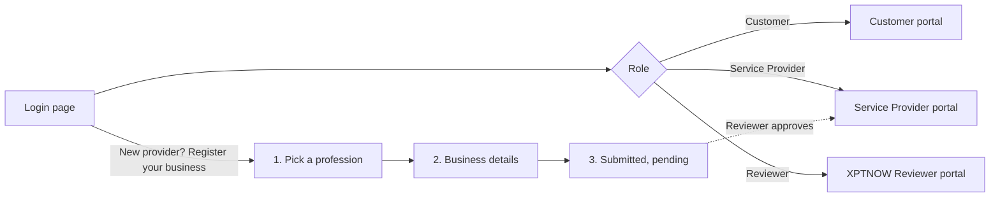
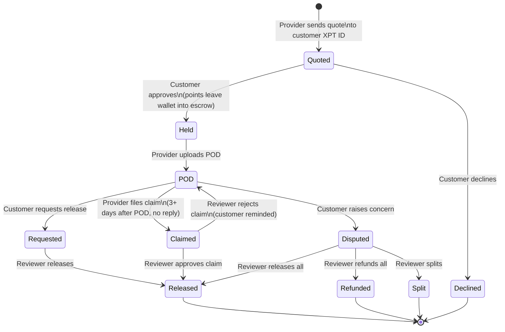
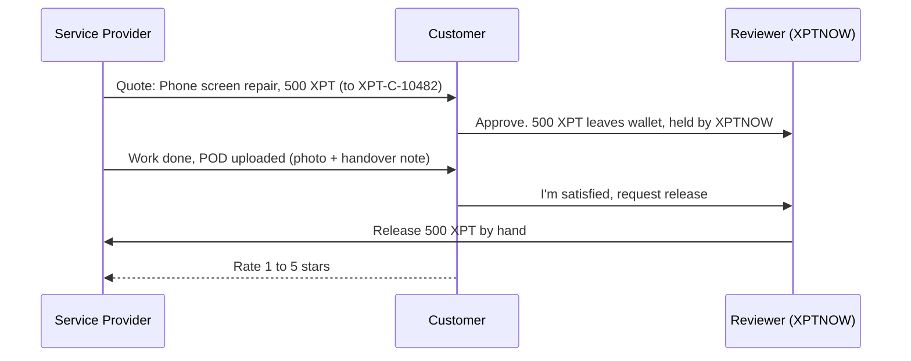

# #02 AppFlow: XPTNOW Escrow Marketplace

How people move through the portal: login, navigation, the escrow job lifecycle and who acts when. The [live demo](https://claude.ai/artifact/K73aknsXmo8UgSJqHWmBGE) follows this flow exactly.

---

## 1. Entry: one login, role-based consoles

- One login page with three role cards. The email is pre-filled per role and any password works (demo only).
- "Register your business" appears only when **Service Provider** is selected.
- In the demo, the user menu has **Switch role**, **Restart demo** and **Sign out**. Switching is always done by the user, never automatically.

## 2. Sidebar navigation per role

| Role | Section | Items |
|---|---|---|
| Customer | My account | Home, Find a provider, Quotes, My services |
| | Money | XPT wallet |
| | Support | Help & FAQ |
| Service Provider | Overview | Dashboard |
| | Work | My services, Send a quote, Jobs |
| | Money | XPT wallet |
| | Account | Business profile |
| Reviewer | Overview | Priority queue |
| | Escrow | Release requests, Claims, Disputes, Escrow ledger |
| | Providers | Provider approvals, All providers |
| | Admin | All jobs, Roles & permissions |

Amber badges show items that need the user (a new quote, a job to work on, a claim, a pending provider).

## 3. Job lifecycle (state machine)

One escrow job moves through these states. The **owner** is the role that must act next.

| State | Label in UI | Owner (next action) | What the owner does |
|---|---|---|---|
| Quoted | Quote sent | Customer | Approve or decline |
| Held | Points on hold | Provider | Do the work, upload POD |
| POD | Proof uploaded | Customer | Request release or raise a concern. After 3 days, the provider may claim. |
| Requested | Release requested | Reviewer | Release by hand |
| Claimed | Claim filed | Reviewer | Approve (release) or reject |
| Disputed | In dispute | Reviewer (provider may reply first) | Release, refund, or split |
| Released / Refunded / Split | Released / Refunded / Settled (split) | None | Job closed, customer can rate |
| Declined | Quote declined | None | No points moved |

## 4. Happy path

## 5. Exception paths

**A. Customer stays silent (claim)**
1. POD is uploaded. A 3-day window starts (the demo has "Skip 1 day" to move time along).
2. After 3 days with no reply, the provider presses **File a claim**.
3. The Reviewer checks the proof and either **approves the claim** (points released) or **rejects** it (job goes back to Proof uploaded and the customer is reminded).

**B. Customer is not happy (dispute)**
1. After POD, the customer presses **Raise a concern** and picks a reason (e.g. "Screen still flickers").
2. The provider can reply with their side.
3. The Reviewer sees three cards (customer says, provider says, evidence) and chooses **Release all to provider**, **Refund all to customer**, or **Apply split** with a refund amount (default half).

## 6. Screen-by-screen flows

### Customer
- **Home:** greeting with the XPT ID and a Copy button, stat tiles (available, on hold, open services, completed), "Needs your attention", job timeline.
- **Find a provider:** profession filter chips, provider cards (name, profession, location, verified badge, rating, jobs, "from" price), "Ask for a quote".
- **Quotes:** the quote card (provider, service, price, complete by), escrow explainer, **Approve and hold N XPT** or **Decline**.
- **My services:** job card with POD tiles, "Are you happy with the service?" box: **I'm satisfied, request release** or **Raise a concern**. After closing: outcome and star rating.
- **XPT wallet:** available, on hold, transactions. **Help & FAQ:** accordions.

### Service Provider
- **Dashboard:** wallet and job stats, "Needs your action", job timeline.
- **My services:** catalog with editable XPT prices, checked against the profession limits.
- **Send a quote:** customer XPT ID lookup (or "Use the demo customer"), service, amount, description, complete-by date, **Send quote**.
- **Jobs:** job card, escrow box, POD tiles (both required), **Upload POD and mark done**, 3-day countdown, **File a claim**, reply to a concern.
- **XPT wallet** and **Business profile** (profession, XPT ID, verified status).

### Reviewer
- **Priority queue:** stat tiles (points in escrow, waiting on you, time to release, dispute rate) and every item waiting on a reviewer, newest first.
- **Release requests / Claims / Disputes:** the decision screens in section 5.
- **Escrow ledger:** every held, released, refunded and split amount.
- **Provider approvals:** pending registrations with **Approve** or **Reject**. **All providers**, **All jobs** (filters + search), **Roles & permissions**.

## 7. Notifications (who hears what)

| Event | Notified |
|---|---|
| Quote sent | Customer |
| Quote approved, points on hold | Provider, Reviewer |
| Quote declined | Provider |
| POD uploaded | Customer |
| Release requested | Reviewer, Provider |
| Concern raised | Reviewer, Provider |
| Provider replied | Reviewer |
| Claim filed | Reviewer, Customer |
| Claim rejected | Provider, Customer |
| Points released / refunded / split | Customer, Provider |
| Customer rated the provider | Provider |
| New provider registration | Reviewer |
