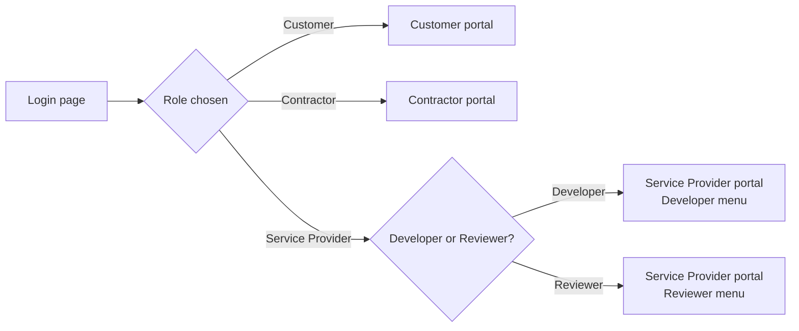
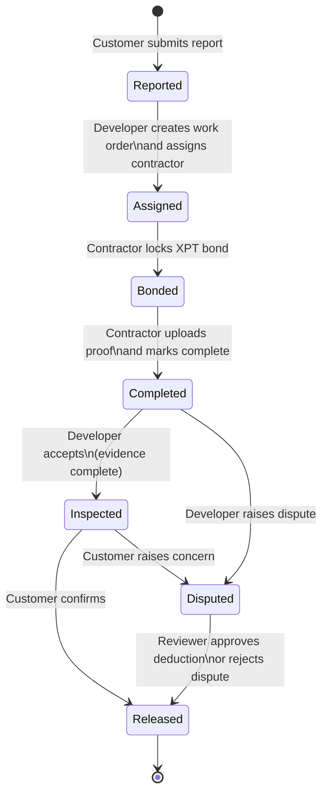
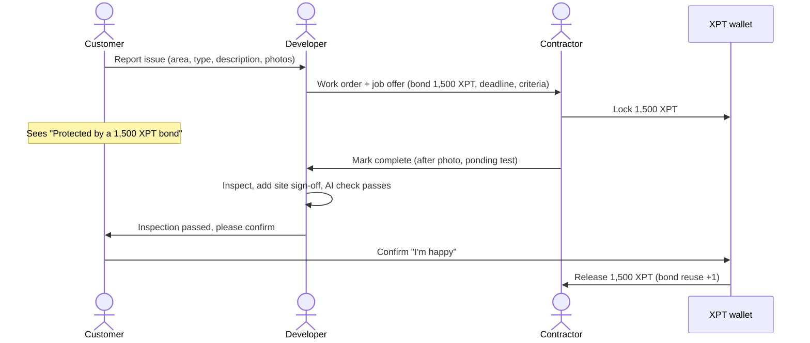
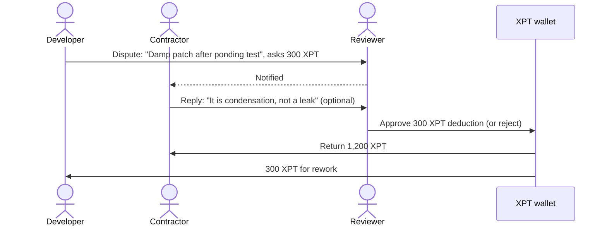

# #02 AppFlow: XPTNOW Service Bond Portal

How people move through the product, screen by screen and step by step. Read this alongside [PRD](PRD.md) and [UI_Spec](UI_Spec.md).

---

## 1. Entry: one login, role-based consoles

- The login page shows three role cards: **Customer**, **Contractor** and **Service Provider**. Choosing Service Provider shows a **Developer / Reviewer** toggle.
- After sign-in, the user lands on their console's **Home** (or **Overview**).
- **Demo only:** the user menu (top right) has **Switch role**, **Restart demo** and **Sign out**.

## 2. Sidebar navigation per role

| Customer | Contractor | Developer | Reviewer |
|---|---|---|---|
| **My home**: Home, Report an issue, My repairs | **Work**: Home, Job offers, Active jobs | **Overview**: Overview | **Overview**: Overview |
| **Support**: Help & FAQ | **Money**: XPT wallet | **Work**: Customer reports, Jobs, Inspections | **Work**: Disputes, Jobs (view only) |
| | | **Admin**: Contractors, Roles & permissions | **Admin**: Roles & permissions |

- Section headers (e.g. *Work*) expand or collapse their items.
- The collapse arrow shrinks the sidebar to icons only. On a phone, the sidebar is a slide-in drawer opened from the menu button.
- An amber **badge** on a menu item means "something here needs you" (e.g. Inspections **1**).
- The top bar shows the portal name, the page title, a **notifications bell** with an unread count, and the user menu.

## 3. Job lifecycle (state machine)

One repair job (work order) moves through these states. The **owner** is the role that must act next.

| State | Label shown in UI | Owner (next action) | What the owner does |
|---|---|---|---|
| Reported | New report | Developer | Create work order, assign contractor, set bond |
| Assigned | Awaiting bond | Contractor | Accept offer and lock XPT |
| Bonded | Repair in progress | Contractor | Fix it, upload after photo and ponding test |
| Completed | Awaiting inspection | Developer | Inspect; accept or dispute |
| Inspected | Awaiting customer | Customer | Confirm, or raise a concern |
| Disputed | In dispute | Reviewer (Contractor may reply first) | Decide the deduction |
| Released | Bond released | None | Job closed |

## 4. Happy path (no dispute)

## 5. Dispute paths

**A. The developer disputes at inspection**

**B. The customer raises a concern after inspection**

The same as A, except the dispute is raised by the Customer from **My repairs** ("Raise a concern"). The Reviewer sees three sides: what the Customer says, what the Contractor says, and the evidence.

Rules:
- The Developer **cannot** decide their own dispute. The Reviewer always decides.
- The contractor's reply is optional. The Reviewer can decide without it.
- The deducted amount is capped at the locked amount.

## 6. Screen-by-screen flows

### Customer
1. **Home**: greeting and unit card. If there's no open repair, a "Report an issue" button. If there is one, the current repair with its status chip and a "Waiting on: …" box. A bond-protection card appears once the bond is locked.
2. **Report an issue**: area, issue type, description, photo tiles → **Submit report** → toast "Report sent to the developer" → goes to **My repairs**.
3. **My repairs**: the current repair, its timeline, and past repairs. When the state is *Inspected*, it shows the after photos with **Yes, I'm happy** or **Raise a concern** (reason → **Send to reviewer**).
4. **Help & FAQ**: what XPT is, what a bond is, what to do if unhappy, and whether the customer pays anything.

### Contractor
1. **Home**: wallet stats, a "Needs your action" card, and the job timeline.
2. **Job offers**: the offer details, acceptance criteria, and "Lock N XPT to accept" → **Accept and lock** (disabled if the balance is too low).
3. **Active jobs**: upload the after photo and ponding test → **Mark repair complete**. If disputed: the reason and **Your side** → **Send to reviewer**. If released: the return split.
4. **XPT wallet**: Available / Locked / Bond reuse / Jobs, plus a transactions table.

### Developer
1. **Overview**: metrics strip (acceptance time, dispute rate, bond reuse, open jobs), "Needs your attention", live job timeline, and the jobs table.
2. **Customer reports**: the report with photos → **Create work order** (contractor, deadline, bond slider) → **Create and send to contractor**.
3. **Jobs**: filters and search → **Open** a job for its details and timeline.
4. **Inspections**: evidence tiles (after photo, ponding test, own site sign-off), the AI check, **Accept work** (enabled only when complete) or **Raise a dispute** (reason, requested XPT).
5. **Contractors**: active bonds, jobs done, dispute rate, bond reuse.
6. **Roles & permissions**: the RBAC matrix, with the current role highlighted.

### Reviewer
1. **Overview**: metrics, "Needs your attention", and the live timeline.
2. **Disputes** (reviewer only): three side cards (raiser, contractor, evidence), a deduction input, and **Approve and release** or **Reject, return full bond**.
3. **Jobs (view only)** and **Roles & permissions**.

## 7. Notifications (who hears what)

| Event | Notified roles |
|---|---|
| Report submitted | Developer |
| Work order created | Contractor (job offer), Customer (contractor assigned) |
| Bond locked | Developer, Customer |
| Repair completed | Developer, Customer |
| Inspection passed | Customer, Contractor |
| Dispute or concern raised | Reviewer, Contractor (plus Developer if the customer raised it) |
| Contractor replied | Reviewer |
| Bond released or decision made | All parties |
