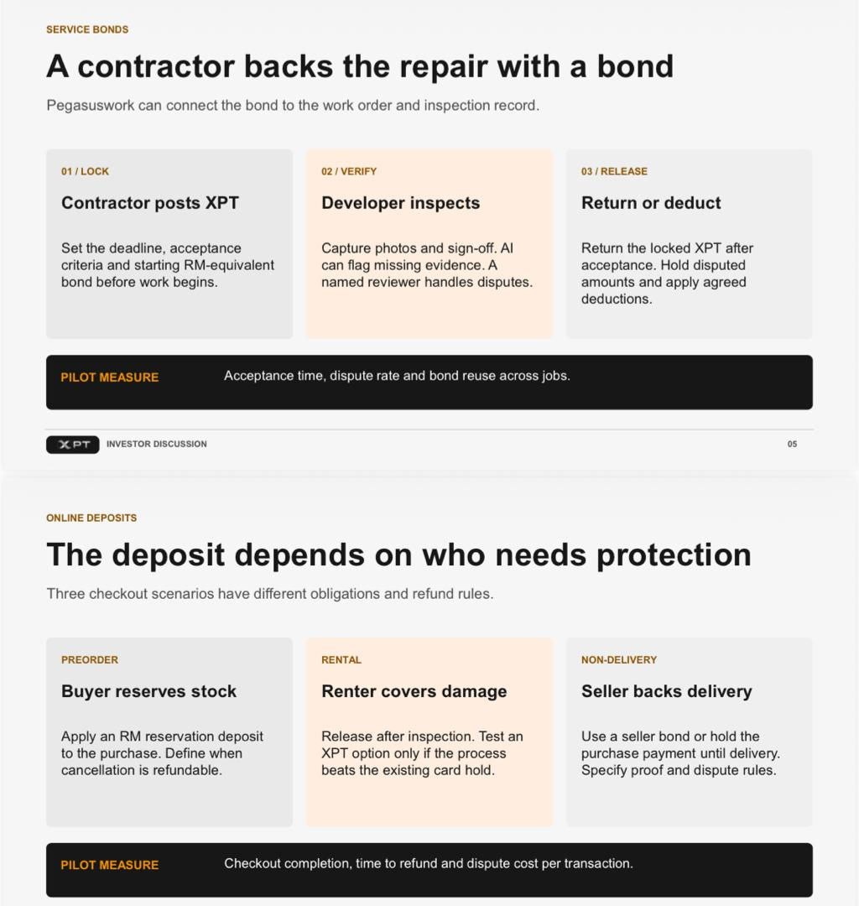

# #01 PRD: XPTNOW Escrow Marketplace

| | |
|---|---|
| **Document** | Product Requirements Document |
| **Product** | XPTNOW Escrow Marketplace (investor demo, design phase) |
| **Owner** | Zannat (UI/UX design) |
| **Status** | Draft for review |
| **Last updated** | 9 Nov 2026 |
| **Live demo** | [XPTNOW Escrow Demo](https://claude.ai/artifact/K73aknsXmo8UgSJqHWmBGE) |

Related docs: [AppFlow](AppFlow.md) · [UI_Spec](UI_Spec.md) · [TRD](TRD.md) · [Schema](Schema.md) · [Plan](Plan.md)

---

## 1. Source context

The work started from two slides of the XPT investor discussion deck: **Service bonds** and **Online deposits**.

The slides gave the core idea: **XPT points are locked as a guarantee, checked against proof, and then released or deducted by a neutral reviewer.** Pilot measures on the slides were acceptance time, dispute rate and bond reuse.

On 9 Nov 2026 the product owner turned this into one simpler model, **an escrow marketplace like freelancer.com, paid in XPT points**:

> A mobile shop keeper (service provider) wants to repair a phone for 500 XPT. The provider sets the XPT price and shares it with the customer by ID. After the customer approves, 500 XPT is deducted from the customer's XPT wallet and held by the Reviewer (XPTNOW). After the work is done, the provider uploads POD. If the customer is satisfied, they ask the Reviewer to release the points to the provider. If the customer never asks, the provider can file a claim with the Reviewer.

This replaces the earlier contractor-bond portal (v7) and the separate "Online Deposits / XPT Hold" idea. See the [Plan](Plan.md#1-decision-log) for the history.

## 2. Problem

When a customer pays for a service up front, either side can be let down:
- The **customer** pays first and has no protection if the work is poor or never done.
- The **provider** does the work first and has no guarantee they will be paid.
- **Disagreements** have no neutral process, so they drag on.

## 3. Solution

A web portal where every service is **paid in XPT points through escrow**:
1. The provider sends a quote in XPT points to the customer's XPT ID.
2. The customer approves, and the points move from their wallet into escrow, **held by XPTNOW**.
3. The provider does the work and uploads **proof of delivery (POD)**.
4. The customer requests release, and an XPTNOW **Reviewer releases the points by hand**.
5. If the customer stays silent for **3 days after POD**, the provider can **file a claim**. If the customer raises a concern, the Reviewer decides: release, refund, or split.

One login portal, with **role-based consoles (RBAC)**. **XPT points only: no RM is shown anywhere.**

## 4. Users and roles

| Role | Who | Console | Main goal |
|---|---|---|---|
| **Customer** | Anyone paying for a service | Customer portal | Find a provider, approve a quote, get the work done, then release or raise a concern |
| **Service Provider** | Contractor, mobile/electronics repair, shop owner or retailer, dealer, rental, freelancer | Service Provider portal | Register with a profession, set XPT prices, send quotes, prove the work, get paid |
| **Reviewer** | XPTNOW team, the points owner and neutral escrow holder | Reviewer portal | Hold points, release or refund them by hand, decide claims and disputes, approve providers |

The old **Developer** role is dropped. Its work (checking proof, approving providers) now sits with the Reviewer, who has the most priority tasks.

## 5. Goals and success measures

| Goal | Measure |
|---|---|
| Fast, fair payouts | **Time to release:** from POD uploaded to points released |
| Fewer disputes | **Dispute rate:** disputed jobs ÷ completed jobs |
| Trust on both sides | **Claim rate:** jobs where the provider had to file a claim |
| Healthy supply | **Provider approvals:** time from registration to verified |

## 6. Scope (this phase)

**In scope**
- Login portal with three roles, plus provider **registration** (pick a profession → business details → submitted for review).
- **Customer:** Home (XPT ID with copy), Find a provider (filter by profession, verified badge, ratings), Quotes (approve or decline), My services (POD, request release, raise a concern, rate), XPT wallet, Help & FAQ.
- **Service Provider:** Dashboard, My services (catalog prices within profession limits), Send a quote (by customer XPT ID), Jobs (upload POD, claim after 3 days), XPT wallet, Business profile.
- **Reviewer:** Priority queue, Release requests, Claims, Disputes, Escrow ledger, Provider approvals, All providers, All jobs, Roles & permissions.
- Job timeline on every console, and in-app notifications.
- Investor-demo helpers: "Switch role", "Restart demo", and "Skip 1 day" to show the 3-day claim window.

**Out of scope (this phase)**
- Real authentication, payments, XPT ledger integration and file storage. These are covered as requirements in the [TRD](TRD.md).
- How customers get XPT points (top-up), point expiry, and fees. These are open questions.
- Integration with the live xptnow.ai codebase. This design work is deliberately separate.

## 7. Functional requirements

| ID | Requirement | Role |
|---|---|---|
| FR-01 | Sign in on one portal; the role decides which console opens | All |
| FR-02 | Collapsible sidebar with grouped, expandable sections; clicking an item changes the view | All |
| FR-03 | Register a business: choose a profession first, then business details; the account stays pending until a Reviewer approves it | Provider |
| FR-04 | Set XPT prices per service, within the profession's minimum and maximum | Provider |
| FR-05 | Send a quote (service, XPT amount, description, complete-by date) to a customer by XPT ID; the ID is checked before sending | Provider |
| FR-06 | Find providers by profession, with verified badge, rating, job count and "from" price | Customer |
| FR-07 | Approve or decline a quote; on approval the amount moves from the customer's wallet to escrow | Customer |
| FR-08 | See points on hold, held by XPTNOW, on every open job | Customer, Provider |
| FR-09 | Upload POD (work photo and signed handover note); both are required | Provider |
| FR-10 | Request release when satisfied, or raise a concern with a reason | Customer |
| FR-11 | File a claim when the customer has not replied **3 days after POD** | Provider |
| FR-12 | Reply to a concern with their side | Provider |
| FR-13 | Release held points to the provider, **by hand only** | Reviewer |
| FR-14 | Decide a claim: approve (release) or reject (job goes back to waiting on the customer, who is reminded) | Reviewer |
| FR-15 | Decide a dispute: release all, refund all, or split with a refund amount | Reviewer |
| FR-16 | Approve or reject provider registrations | Reviewer |
| FR-17 | Priority queue that lists everything waiting on a Reviewer | Reviewer |
| FR-18 | Escrow ledger and all-jobs table with filters and search | Reviewer |
| FR-19 | Rate the provider after release | Customer |
| FR-20 | Job timeline on every console with done, now and upcoming steps, and "YOU" tags | All |
| FR-21 | Notifications for each hand-off between roles | All |
| FR-22 | Wallet: available, on hold, transactions | Customer, Provider |
| FR-23 | Roles & permissions page showing the RBAC matrix | Reviewer |

## 8. Business rules

1. Only a **verified** provider can send quotes.
2. A quote amount must be within the provider's profession limits (see [Schema §4](Schema.md#4-demo-seed-data-illustrative)).
3. Points leave the customer's wallet **only when the customer approves** the quote, and go straight into escrow held by XPTNOW.
4. The customer must have enough available points to approve.
5. Release is **never automatic**. Only a Reviewer can release, refund or split, and always by hand.
6. A provider can file a claim **only 3 days or more after POD**, and only if the customer has not requested release or raised a concern.
7. While a job is in escrow, nobody can spend those points.
8. A refund or split can never exceed the held amount.
9. All amounts are in **XPT points only**. No RM or other currency is shown.
10. The UI never switches a user to another role or page after an action. Only the user switches.

## 9. Assumptions and open questions

- **Assumption:** XPTNOW employs the Reviewers, and a Reviewer never reviews a job they are part of.
- **Assumption:** points in escrow sit in an XPTNOW escrow account until a Reviewer acts.
- **Open:** how customers and providers get XPT points (top-up, rewards, purchase).
- **Open:** do points expire?
- **Open:** does XPTNOW take a fee on a release?
- **Open:** is there a time limit for the Reviewer to act on a release request?
- **Open:** where the real brand assets (SVG logo, exact hex codes) will come from.
