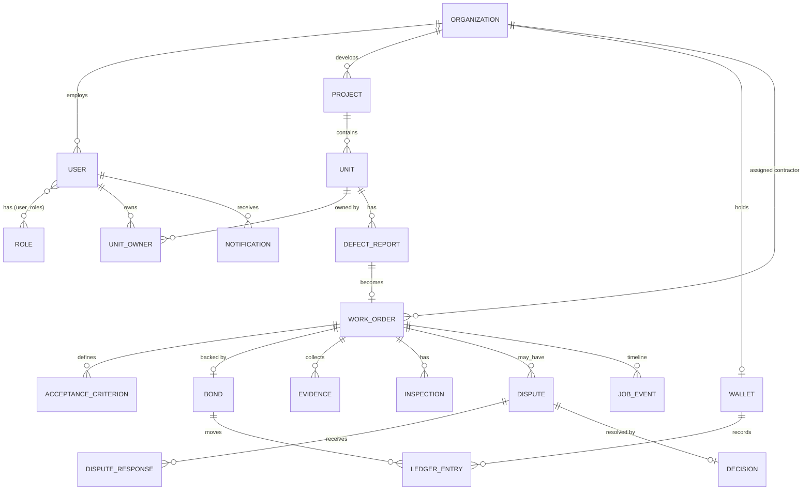

# #05 Schema: XPTNOW Service Bond Portal

The data model behind the portal. Field names are suggestions for the engineering team. The demo uses the same concepts with mock data.

---

## 1. Entity relationship diagram

## 2. Tables

### Identity and access
| Table | Key fields |
|---|---|
| `organizations` | `id`, `name`, `type` (`developer` · `contractor` · `reviewer_body`) |
| `users` | `id`, `org_id` (nullable for customers), `full_name`, `email`, `phone`, `created_at` |
| `roles` | `id`, `key` (`customer` · `contractor` · `developer` · `reviewer`), `label` |
| `permissions` | `id`, `key` (e.g. `work_order.create`), `description` |
| `role_permissions` | `role_id`, `permission_id` |
| `user_roles` | `user_id`, `role_id`, `project_id` (nullable: lets a role be scoped to one project) |

### Property
| Table | Key fields |
|---|---|
| `projects` | `id`, `developer_org_id`, `name` (e.g. Residensi Taman Melur), `dlp_end_date` |
| `units` | `id`, `project_id`, `code` (e.g. B-12-03) |
| `unit_owners` | `unit_id`, `user_id`, `since` |

### Repairs
| Table | Key fields |
|---|---|
| `defect_reports` | `id`, `unit_id`, `reported_by`, `area`, `issue_type`, `description`, `status`, `created_at` |
| `work_orders` | `id` (e.g. WO-24817), `report_id`, `project_id`, `unit_id`, `contractor_org_id`, `reviewer_user_id`, `state` (see below), `bond_required_xpt`, `deadline`, `created_by`, `created_at` |
| `acceptance_criteria` | `id`, `work_order_id`, `text`, `sort` |
| `evidence` | `id`, `work_order_id`, `kind` (`report_photo` · `after_photo` · `ponding_test` · `site_signoff` · `other`), `file_url`, `uploaded_by`, `created_at` |
| `inspections` | `id`, `work_order_id`, `inspector_id`, `result` (`accepted` · `disputed`), `ai_check` (JSON: missing items), `created_at` |

`work_orders.state` is one of `reported`, `assigned`, `bonded`, `completed`, `inspected`, `disputed`, `released` (see [AppFlow §3](AppFlow.md#3-job-lifecycle-state-machine)).

### Disputes
| Table | Key fields |
|---|---|
| `disputes` | `id`, `work_order_id`, `raised_by`, `raised_by_role` (`developer` · `customer`), `reason`, `requested_deduction_xpt`, `status` (`open` · `decided`), `created_at` |
| `dispute_responses` | `id`, `dispute_id`, `user_id`, `role`, `message`, `evidence_id` (nullable), `created_at` |
| `decisions` | `id`, `dispute_id`, `reviewer_id`, `outcome` (`approved` · `rejected`), `deduction_xpt`, `note`, `created_at` |

### XPT money
| Table | Key fields |
|---|---|
| `wallets` | `id`, `org_id`, `currency` (`XPT`) |
| `bonds` | `id`, `work_order_id`, `wallet_id`, `amount_xpt`, `status` (`locked` · `released` · `partially_released`), `locked_at`, `released_at`, `returned_xpt`, `deducted_xpt` |
| `ledger_entries` | `id`, `wallet_id`, `bond_id` (nullable), `account` (`available` · `locked` · `deduction`), `amount_xpt` (+/−), `idempotency_key`, `external_ref` (nullable: XPT network or partner reference), `created_at` |

Balances: `available = Σ entries where account='available'`, and `locked = Σ entries where account='locked'`. **Bond reuse** = the count of bonds released back to a wallet and then re-locked.

### Activity
| Table | Key fields |
|---|---|
| `job_events` | `id`, `work_order_id`, `actor_id`, `actor_role`, `type` (e.g. `bond_locked`), `from_state`, `to_state`, `payload` (JSON), `created_at`. This is the audit log and feeds the timeline. |
| `notifications` | `id`, `user_id`, `job_event_id`, `text`, `read_at`, `created_at` |

## 3. RBAC permission matrix

| Permission key | Customer | Contractor | Developer | Reviewer |
|---|:-:|:-:|:-:|:-:|
| `report.create` (own unit) | ✓ | | | |
| `work_order.confirm_or_concern` (own unit) | ✓ | | | |
| `job_offer.view_and_lock` (assigned to them) | | ✓ | | |
| `evidence.upload_completion` | | ✓ | | |
| `dispute.reply` | | ✓ | | |
| `work_order.create_and_assign` | | | ✓ | |
| `inspection.accept_or_dispute` | | | ✓ | |
| `work_order.view_all` (project) | | | ✓ | ✓ (read) |
| `dispute.decide` | | | | ✓ |
| `rbac.view` | | | ✓ | ✓ |

## 4. Demo seed data (illustrative)

| Thing | Value |
|---|---|
| Customer | Aina Rahman, Unit B-12-03, Residensi Taman Melur |
| Contractor | Sinar Jaya Renovation (wallet 3,500 XPT available, bond reuse 4) |
| Developer | Farid Hassan, Residensi Taman Melur |
| Reviewer | Nur Aisyah, Pegasuswork |
| Live job | WO-24817, bathroom floor leak, bond 1,500 XPT, deadline 5 Dec 2026 |
| Sample jobs | WO-24802 (Kilat Builders, bonded), WO-24790 and WO-24771 (released) |

All names, amounts and dates are fictional and for demonstration only.
