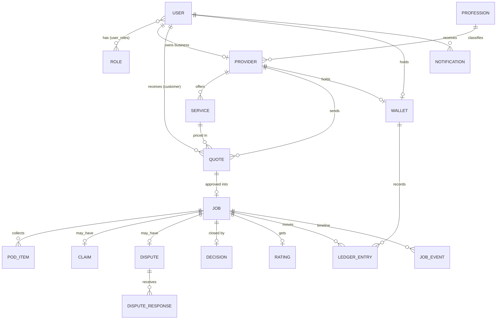

# #05 Schema: XPTNOW Escrow Marketplace

The data model behind the portal. Field names are suggestions for the engineering team. The demo uses the same concepts with mock data.

---

## 1. Entity relationship diagram

## 2. Tables

### Identity and access
| Table | Key fields |
|---|---|
| `users` | `id`, `xpt_id` (e.g. XPT-C-10482, unique), `full_name`, `email`, `phone`, `created_at` |
| `roles` | `id`, `key` (`customer` · `provider` · `reviewer`), `label` |
| `permissions` | `id`, `key` (e.g. `quote.send`), `description` |
| `role_permissions` | `role_id`, `permission_id` |
| `user_roles` | `user_id`, `role_id` |

### Providers
| Table | Key fields |
|---|---|
| `professions` | `id`, `key` (`contractor` · `mobile` · `retail` · `dealer` · `rental` · `freelance`), `label`, `min_xpt`, `max_xpt` |
| `providers` | `id`, `xpt_id` (e.g. XPT-P-2201), `owner_user_id`, `profession_id`, `business_name`, `ssm_no`, `location`, `email`, `status` (`pending` · `verified` · `rejected`), `verified_by`, `verified_at`, `rating_avg`, `jobs_count` |
| `services` | `id`, `provider_id`, `name`, `price_xpt` (within profession limits), `active` |

### Quotes and jobs
| Table | Key fields |
|---|---|
| `quotes` | `id`, `provider_id`, `customer_user_id`, `service_id`, `amount_xpt`, `description`, `complete_by`, `status` (`sent` · `approved` · `declined` · `expired`), `created_at` |
| `jobs` | `id` (e.g. ESC-3120), `quote_id`, `provider_id`, `customer_user_id`, `amount_xpt`, `state` (see below), `pod_at`, `claim_open_at` (= `pod_at` + 72h), `reviewer_user_id` (nullable), `created_at`, `closed_at` |
| `pod_items` | `id`, `job_id`, `kind` (`work_photo` · `handover_note` · `other`), `file_url`, `uploaded_at` |
| `claims` | `id`, `job_id`, `filed_at`, `status` (`open` · `approved` · `rejected`) |
| `disputes` | `id`, `job_id`, `raised_by`, `reason`, `status` (`open` · `decided`), `created_at` |
| `dispute_responses` | `id`, `dispute_id`, `user_id`, `role`, `message`, `created_at` |
| `decisions` | `id`, `job_id`, `reviewer_id`, `outcome` (`release` · `refund` · `split` · `reject_claim`), `to_provider_xpt`, `to_customer_xpt`, `note`, `created_at` |
| `ratings` | `job_id`, `customer_user_id`, `provider_id`, `stars` (1 to 5), `created_at` |

`jobs.state` is one of `held`, `pod`, `requested`, `claimed`, `disputed`, `released`, `refunded`, `split` (see [AppFlow §3](AppFlow.md#3-job-lifecycle-state-machine)). A declined quote never becomes a job.

Rule: for every decision, `to_provider_xpt + to_customer_xpt = jobs.amount_xpt`.

### XPT points
| Table | Key fields |
|---|---|
| `wallets` | `id`, `owner_type` (`user` · `provider` · `xptnow_escrow`), `owner_id`, `unit` (`XPT`) |
| `ledger_entries` | `id`, `wallet_id`, `job_id` (nullable), `account` (`available` · `escrow`), `amount_xpt` (+/−), `idempotency_key`, `external_ref` (nullable: XPT network or partner reference), `created_at` |

Balances are sums of entries. The customer's **On hold** figure is the sum of escrow entries for their open jobs. XPTNOW's **Points in escrow** is the balance of the `xptnow_escrow` wallet.

### Activity
| Table | Key fields |
|---|---|
| `job_events` | `id`, `job_id`, `actor_id`, `actor_role`, `type` (e.g. `quote_approved`), `from_state`, `to_state`, `payload` (JSON), `created_at`. This is the audit log and feeds the timeline. |
| `notifications` | `id`, `user_id`, `job_event_id`, `text`, `read_at`, `created_at` |

## 3. RBAC permission matrix

| Permission | Customer | Service Provider | Reviewer |
|---|:-:|:-:|:-:|
| Register a business and choose a profession | | ✓ | |
| Create services and set the XPT price | | ✓ | |
| Send a quote to a customer by XPT ID | | ✓ | |
| Upload proof of delivery (POD) | | ✓ | |
| File a claim (3 days after POD, no customer reply) | | ✓ | |
| Approve a quote (points go on hold) | ✓ | | |
| Request release or raise a concern | ✓ | | |
| Rate a provider | ✓ | | |
| Hold points in escrow | | | ✓ |
| Release or refund held points (by hand) | | | ✓ |
| Approve provider registrations | | | ✓ |
| Decide claims and disputes | | | ✓ |
| See all jobs and the escrow ledger | | | ✓ |

## 4. Demo seed data (illustrative)

**Professions and XPT price limits per service**

| Profession | Examples | Min | Max |
|---|---|--:|--:|
| Contractor | Renovation, plumbing, wiring | 100 | 10,000 |
| Mobile & electronics repair | Phones, laptops, tablets | 50 | 3,000 |
| Shop owner / Retailer | Goods, preorders, custom items | 20 | 5,000 |
| Dealer | Vehicles, machinery | 100 | 20,000 |
| Rental | Cameras, tools, equipment | 50 | 5,000 |
| Freelancer / Other | Design, tutoring, other services | 20 | 5,000 |

**People and jobs**

| Thing | Value |
|---|---|
| Customer | Aina Rahman, XPT-C-10482, wallet 2,000 XPT |
| Service Provider | FixIt Mobile, XPT-P-2201, Mobile & electronics repair, Kota Damansara, 4.8★, wallet 3,200 XPT |
| Reviewer | Nur Aisyah, XPTNOW |
| FixIt Mobile catalog | Phone screen repair 500, Battery replacement 250, Water damage check 150 (XPT) |
| Live job | ESC-3120, Phone screen repair, 500 XPT, complete by 12 Nov 2026 |
| Other providers | CoolAir Services (contractor), LensHire KL (rental), Kayu Craft Studio (retail), all verified; Kilat Rentals (rental), pending |
| Sample jobs | ESC-3117 and ESC-3109 (held), ESC-3098 and ESC-3085 (released) |
| Registration example | Ah Seng Gadget Repair, Puchong |

All names, amounts and dates are fictional and for demonstration only.
